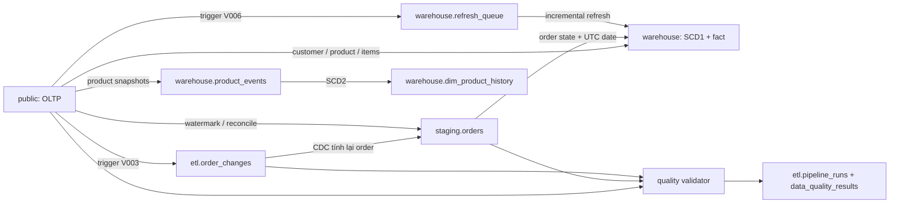
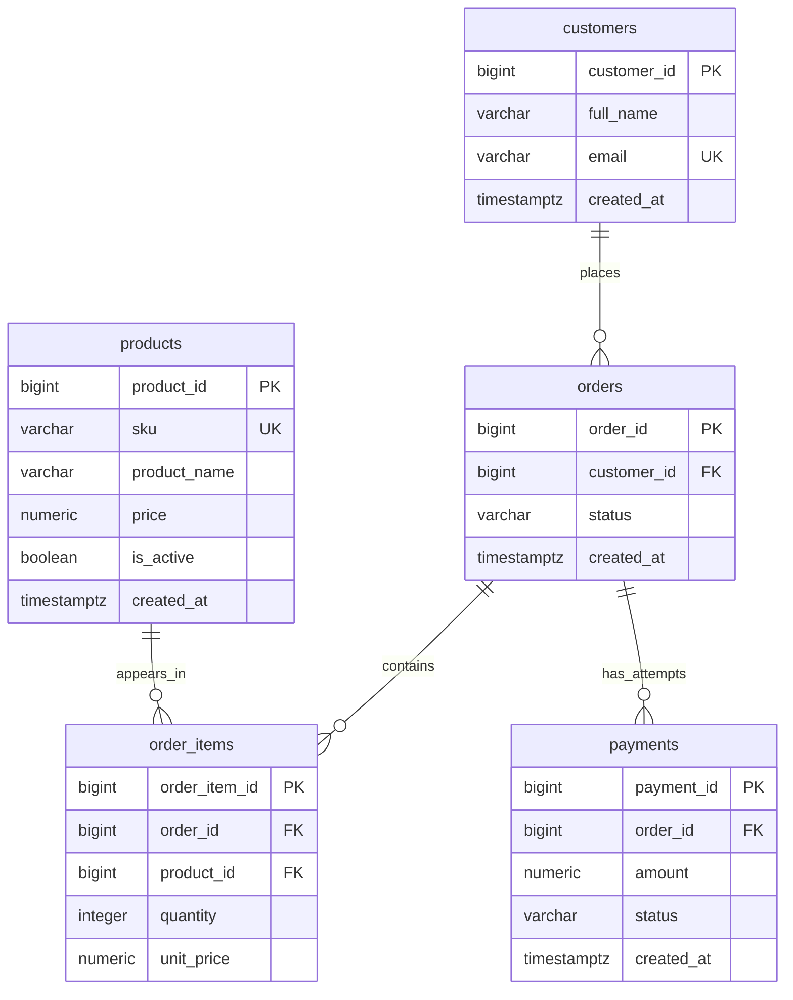
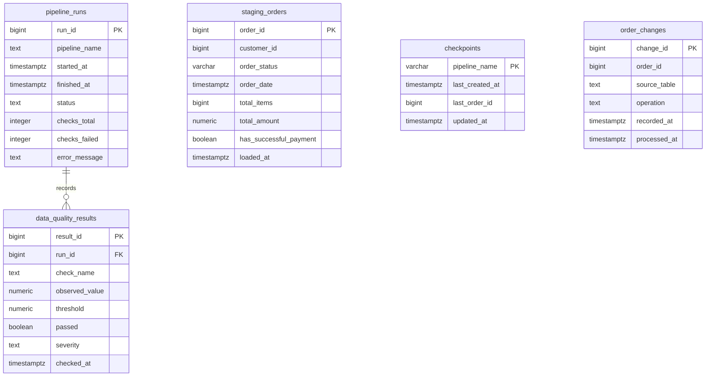
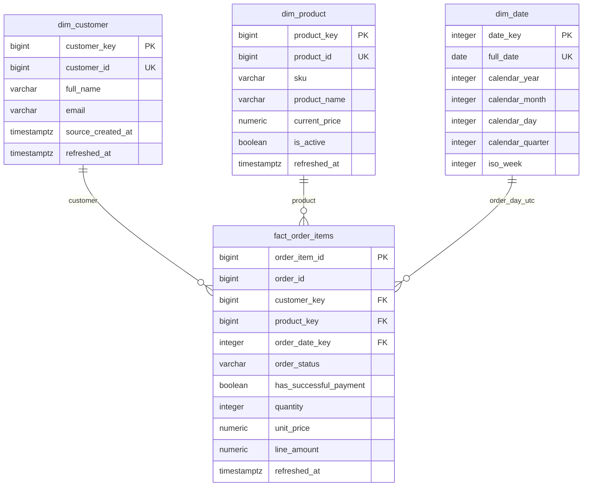
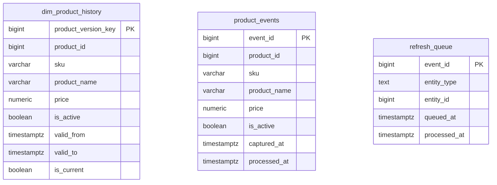

# Mô hình dữ liệu NovaCommerce

## 1. Các lớp dữ liệu

Mô hình dựa trên [V001–V006](../database/migrations), gồm 17 bảng trong bốn schema.
Các sơ đồ Mermaid dưới đây mô tả quan hệ có FK thực tế. Quan hệ lineage xuyên
lớp và tham chiếu logic được giải thích riêng để không nhầm với FK trong DDL.

## 2. OLTP — schema `public`

`||--o{` biểu diễn một parent có từ 0 đến nhiều child; mỗi child tham chiếu đúng
một parent. DDL không bắt buộc order phải có ít nhất một item hoặc payment.

| Bảng | Grain | Ràng buộc chính |
| --- | --- | --- |
| `customers` | Một khách hàng | Identity PK; email unique, NOT NULL; tên tối đa 150 ký tự. |
| `products` | Một sản phẩm hiện tại | Identity PK; SKU unique; `price NUMERIC(15,2) >= 0`. |
| `orders` | Một đơn hàng | Identity PK; FK customer; status thuộc tập 4 giá trị. |
| `order_items` | Một sản phẩm trong một đơn | Identity PK; unique `(order_id, product_id)`; quantity > 0; unit_price NUMERIC(15,2) >= 0. |
| `payments` | Một lần thanh toán/thử thanh toán | Identity PK; FK order; amount NUMERIC(15,2) > 0; status thuộc tập 4 giá trị. |

Tất cả cột trong năm bảng nguồn đều NOT NULL. FK không khai báo `ON DELETE
CASCADE`; xóa parent còn child sẽ bị chặn. Không có unique trên
`payments.order_id`: nhiều payment thành công cho một order vẫn hợp lệ ở mức DDL.

Các index nguồn ngoài PK/unique:

- V001: `orders(customer_id)`, `orders(created_at)`,
  `order_items(product_id)`, `payments(order_id)`.
- V002: `orders(created_at, order_id)` phục vụ watermark ghép.
- Unique `(order_id, product_id)` cũng hỗ trợ lookup item theo order.
- Query `05_query_performance.sql` có thể tạo thêm partial index
  `orders(customer_id) WHERE status = 'COMPLETED'`; index này không thuộc migrations.

## 3. Staging và vận hành ETL

Trong sơ đồ này, `staging_orders` là `staging.orders`; bốn entity còn lại thuộc
schema `etl`. Chỉ `data_quality_results.run_id` có FK đến `pipeline_runs.run_id`.

| Bảng | Grain và ý nghĩa |
| --- | --- |
| `staging.orders` | Một order, tổng hợp toàn bộ item và cờ tồn tại payment SUCCESS. `order_date` là timestamp tạo order nguồn, chưa phải DATE. `total_items` là SUM(quantity), `total_amount NUMERIC(18,2)` là SUM(quantity * unit_price). |
| `etl.checkpoints` | Một dòng cho mỗi pipeline watermark. V002 khởi tạo `orders_pipeline` với `(-infinity, 0)`. CDC không dùng checkpoint này. |
| `etl.order_changes` | Một sự kiện trigger, không phải một order duy nhất; nhiều event có thể cùng order_id. Operation: INSERT/UPDATE/DELETE/BACKFILL. `processed_at IS NULL` nghĩa là pending. |
| `etl.pipeline_runs` | Một lượt quality audit; status RUNNING/SUCCESS/FAILED. Không phải bảng log tự động cho mọi lượt ETL/warehouse. |
| `etl.data_quality_results` | Một check trong một run; unique `(run_id, check_name)`, severity ERROR/WARNING. |

`processed_at`, `pipeline_runs.finished_at` và `pipeline_runs.error_message` có
thể NULL; các cột còn lại ở nhóm bảng này là NOT NULL. Index pending của
`order_changes` là partial index trên `change_id WHERE processed_at IS NULL`;
ngoài ra có index theo `order_id`. Audit có index `(pipeline_name, started_at DESC)`.

`staging.orders.order_id`, `staging.orders.customer_id`,
`checkpoints.last_order_id` và `order_changes.order_id` là tham chiếu logic,
không có FK về nguồn. Điều này cho phép journal giữ event DELETE và loader
chủ động xóa staging tương ứng.

## 4. Warehouse — star schema SCD1

Toàn bộ entity trong sơ đồ thuộc schema `warehouse`; mọi cột đều NOT NULL.
`customer_key` và `product_key` là surrogate identity key; `customer_id` và
`product_id` là natural key nguồn, unique trong dimension SCD1.

| Bảng | Grain và hành vi |
| --- | --- |
| `dim_customer` | Một customer hiện tại; full_name/email được cập nhật đè theo SCD1. Email không có unique riêng trong dimension. |
| `dim_product` | Một product hiện tại; tên, SKU, giá và active được cập nhật đè theo SCD1. `current_price NUMERIC(15,2) >= 0`. |
| `dim_date` | Một ngày UTC có order trong staging. `date_key` là integer YYYYMMDD; iso_week là tuần ISO, calendar_year vẫn là năm lịch. |
| `fact_order_items` | Chính xác một dòng `public.order_items`; `order_item_id` là khóa lineage và khóa idempotent, không phải identity mới. |

Fact giữ trạng thái order và cờ payment lặp lại trên mỗi dòng hàng. Tổng tiền
`line_amount NUMERIC(18,2)` được PostgreSQL sinh và lưu bằng
`GENERATED ALWAYS AS (quantity * unit_price) STORED`; không lấy giá hiện tại từ
dimension để tính lại lịch sử bán hàng. Quantity > 0 và unit_price >= 0.

Fact chỉ có ba FK thực tế đến customer/product/date dimensions. `order_id` và
`order_item_id` không có FK về `public`; `dim_customer.customer_id` và
`dim_product.product_id` cũng không có FK về nguồn. Fact có index riêng trên
`order_date_key`, `product_key`, `customer_key`, `order_id`.

Bảng fact chứa cả đơn chưa hoàn tất/chưa trả tiền. Query doanh thu mới lọc
`order_status = 'COMPLETED' AND has_successful_payment`; khi đếm đơn phải dùng
`COUNT(DISTINCT order_id)` vì grain của fact là dòng hàng.

## 5. Warehouse — product history và refresh queues

Các bảng này thuộc schema `warehouse`, không có FK với nhau hoặc với nguồn.

| Bảng | Grain và ràng buộc |
| --- | --- |
| `dim_product_history` | Một phiên bản thuộc tính product quan sát được. Identity `product_version_key`; `valid_to` có thể NULL, mọi cột khác NOT NULL. CHECK valid_to > valid_from khi có giá trị; CHECK `is_current = (valid_to IS NULL)`. |
| `product_events` | Một snapshot product khi INSERT hoặc đổi SKU/tên/giá/active; chứa payload để giữ nhiều update trước khi loader chạy. `processed_at` có thể NULL. |
| `refresh_queue` | Một dirty-key event PRODUCT/ORDER/CUSTOMER. `entity_id` tùy entity_type nên không có FK đơn nhất. `processed_at` có thể NULL. |

Partial unique index `dim_product_history(product_id) WHERE is_current` bảo đảm
**tối đa** một phiên bản current cho mỗi product; không bảo đảm mọi product đều
có history. Index `(product_id, valid_from DESC)` hỗ trợ tra lịch sử. DDL chưa có
exclusion constraint cấm overlap mọi khoảng lịch sử; việc này được kiểm tra bằng
`tests/validate_day10.sql`.

Khoảng hiệu lực dùng quy ước `[valid_from, valid_to)`. Khi đổi thuộc tính, loader
đóng phiên bản trước và mở phiên bản mới; nếu timestamp bằng nhau thì đẩy đầu
phiên bản mới thêm tối thiểu một microsecond. Phiên bản đầu dùng `-infinity` làm
baseline quan sát, không chứng minh thuộc tính đó đúng từ thời điểm quá khứ vô hạn.
Cột price trong ba bảng history/events/dimension không có cùng bộ CHECK: V006
không khai báo CHECK price >= 0 trên history hoặc product_events.

`product_events` và `refresh_queue` đều có partial index trên `event_id WHERE
processed_at IS NULL`. Hai cột `event_id` là hai sequence độc lập, không phải
khóa join giữa hai bảng. Một refresh event không nhất thiết ứng với một product
snapshot, và một entity có thể có nhiều event pending.

**Fact hiện vẫn tham chiếu `dim_product.product_key`, không tham chiếu
`dim_product_history.product_version_key`.** Muốn phân tích thuộc tính sản phẩm
tại một thời điểm phải định nghĩa phép nối as-of riêng; migration hiện không
thay đổi fact thành mô hình SCD2.

## 6. Lineage và trigger

| Nguồn | Đích | Cơ chế |
| --- | --- | --- |
| `public.orders`, `order_items`, `payments` | `etl.order_changes` | V003: row trigger sau INSERT/UPDATE/DELETE, giữ order_id bị ảnh hưởng. |
| `public.orders` + items/payments | `staging.orders` | Watermark/reconcile hoặc CDC tính lại giá trị hiện tại. |
| `public.customers` | `warehouse.dim_customer` | Full build; incremental theo CUSTOMER dirty key hoặc bổ sung dimension khi nạp order. |
| `public.products` | `warehouse.dim_product` | Full build; incremental theo PRODUCT dirty key hoặc bổ sung khi nạp order. |
| `staging.orders.order_date` | `warehouse.dim_date` | Chuyển UTC date, sinh key YYYYMMDD. |
| `public.order_items` + `staging.orders` + dimensions | `warehouse.fact_order_items` | Full build upsert; incremental xóa/nạp lại các order dirty. |
| `public.products` | `warehouse.product_events` và `refresh_queue` | V006: INSERT/UPDATE thuộc tính được theo dõi; không có DELETE trigger. |
| `public.customers` | `warehouse.refresh_queue` | V006: INSERT/UPDATE; không có DELETE trigger. |
| `public.orders` | `warehouse.refresh_queue` | V006: INSERT/UPDATE/DELETE. |
| `public.order_items`, `payments` | `warehouse.refresh_queue` | V006: INSERT/UPDATE/DELETE; khi chuyển order_id enqueue cả đơn cũ và mới. |
| `warehouse.product_events` | `warehouse.dim_product_history` | Snapshot được xử lý thành phiên bản SCD2 rồi đánh dấu processed. |

Journal CDC và queue warehouse độc lập: xử lý một bên không xác nhận event bên
kia. Incremental warehouse yêu cầu journal CDC không còn pending để giảm nguy
cơ dùng staging cũ. Các tham chiếu logic trên không đồng nghĩa có ràng buộc FK.

Các giới hạn về capture, đồng thời, giá trị `-infinity` và bootstrap được nêu ở
[requirements.md](requirements.md#8-giới-hạn-hiện-tại).
